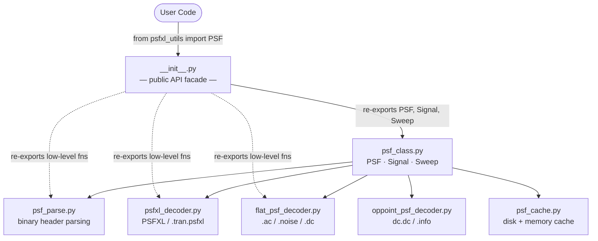

# psfxl_utils

[](LICENSE)

Decode Cadence Spectre PSF binary simulation results into NumPy arrays.
Supports the PSFXL compressed format (`.tran` + `.tran.psfxl`), the flat PSF
format (`.ac`, `.noise`, `.dc`), and the info/op-point format (`dcOp.dc`,
`dcOpInfo.info`).

```python
from psfxl_utils import PSF

psf   = PSF('results/psf/tran.tran')
sweep = psf.get_sweep()            # time axis
vout  = psf.get_signal('vout')     # decoded waveform

print(f"{sweep.name}: {sweep.abscissa[0]:.3g} to {sweep.abscissa[-1]:.3g} {sweep.units}")
print(f"vout range: {vout.ordinate.min():.4f} to {vout.ordinate.max():.4f} {vout.units}")
```

---

## Supported Simulation Types

| Analysis | File | Sweep axis | Signal type |
|----------|------|------------|-------------|
| DC op-point | `dcOp.dc`, `dcOpInfo.info` | — (snapshot) | real scalar |
| DC sweep | `dc.dc` | swept variable | real array |
| Transient | `tran.tran` + `tran.tran.psfxl` | time (s) | real array |
| AC | `ac.ac` | frequency (Hz) | complex array |
| Noise | `noise.noise` | frequency (Hz) | real array (incl. per-mechanism components) |
| Stability | `stb.stb` | frequency (Hz) | complex array |

---

## Installation

```bash
git clone <this repository>
cd psfxl_utils
pip install .
```

Dependencies: `numpy`, `blosc`, `packaging` (installed automatically).

On systems where `blosc` wheels are unavailable (some HPC environments),
`numcodecs` works as a drop-in alternative decompression backend:

```bash
pip install numcodecs   # instead of blosc
```

---

## Quick Start

### DC operating point (scalar access)

```python
from psfxl_utils import PSF

psf = PSF('results/psf/dcOp.dc')

vgs = psf.get_signal('vgs').ordinate[0]
print(f"Vgs = {vgs:.4f} V")

for signal in psf.all_signals():
    print(f'{signal.name:<20} {signal.ordinate[0]:<12.6g} '
          f'{signal.units:<8} {signal.type.kind}')
```

### Transient analysis

```python
psf   = PSF('results/psf/tran.tran')
sweep = psf.get_sweep()          # time axis
vout  = psf.get_signal('vout')   # voltage array
```

### AC / noise (complex signals)

```python
import numpy as np

psf   = PSF('results/psf/ac.ac')
sweep = psf.get_sweep()               # frequency axis (Hz)
vout  = psf.get_signal('vout')        # complex ordinate

gain_db = 20 * np.log10(np.abs(vout.ordinate))
```

More examples — plotting, device operating-point tables, Monte Carlo
post-processing — live in [docs/examples.md](docs/examples.md).

---

## Package Structure

```
psfxl_utils/
├── __init__.py              ← public API (PSF, Signal, Sweep + low-level functions)
├── psf_class.py             ← PSF, Signal, Sweep data classes
├── psf_parse.py             ← shared binary header parsing  [internal]
├── psfxl_decoder.py         ← PSFXL decoder (.tran + .tran.psfxl)  [internal]
├── flat_psf_decoder.py      ← flat PSF decoder (.ac, .noise, .dc)  [internal]
├── oppoint_psf_decoder.py   ← DC op-point / info decoder (.dc, .info)  [internal]
└── psf_cache.py             ← two-level disk + memory caching  [internal]
```



Solid arrows = direct imports. Dashed arrows = re-exported symbols (available
via the package root but owned elsewhere).

Modules marked *internal* are implementation details; normal use goes through
the package root (`from psfxl_utils import PSF`). Their inner workings are
documented in [docs/internals.md](docs/internals.md).

---

## Caching

PSF decoding is expensive for large files. Two transparent caching layers are
applied automatically:

| Layer | Location | Speed | Invalidation |
|-------|----------|-------|--------------|
| In-session memory | `PSF._instance_cache` (dict) | < 1 ms | SHA-256 hash of source file |
| Disk pickle | `~/.cache/psfxl_utils/` | ~50 ms | mtime embedded in filename |

Clear the disk cache when it grows stale:

```python
from psfxl_utils.psf_cache import clear_all
clear_all()
```

Details of the invalidation semantics are in
[docs/internals.md](docs/internals.md#caching).

---

## Documentation

- [docs/examples.md](docs/examples.md) — per-analysis usage examples,
  waveform plotting, Monte Carlo post-processing
- [docs/internals.md](docs/internals.md) — module responsibilities, decode
  pipeline, caching semantics
- [docs/format.md](docs/format.md) — PSF binary format reference (magic
  bytes, sections, chunk layouts) and edge cases

---

## License

MIT — see [LICENSE](LICENSE).
